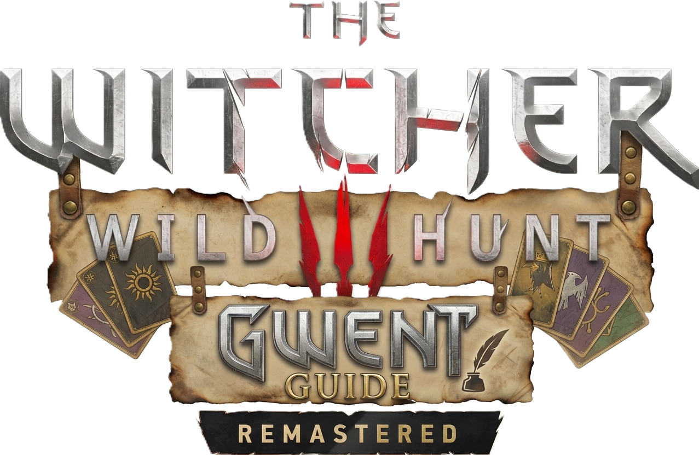

  

<h1 align="center">🐺 Gwent Checklist & Guide</h1>

  <strong>The Witcher 3: Wild Hunt — Gwent Collection Companion</strong>
   
  Your companion for collecting Gwent cards throughout the Northern Kingdoms and beyond.

  
  

  🌎 Available in <strong>Português</strong> and <strong>English</strong>.

---

## 📖 About the Project

**Gwent Checklist & Guide** is an independent fan-made project created to help players of *The Witcher 3: Wild Hunt* organize and track their Gwent card collection.

The project provides an interactive checklist designed to make collecting cards easier, whether you are beginning your first playthrough or working toward completing your collection.

Browse cards, organize your progress, filter cards by faction, and consult the available guides while exploring the world of The Witcher.

The website is accessible directly through your browser, without requiring additional software.

## ✨ Features

- 🃏 **Interactive Card Checklist** — Track the cards in your collection.
- 📚 **Collection Tracking** — Mark collected cards and organize your progress.
- 🛡️ **Faction Filters** — Browse cards according to their factions.
- 🔎 **Card Search** — Find specific cards using the available search tools.
- 🗂️ **Card Categories** — Explore cards organized into groups.
- 🌎 **Bilingual Interface** — Navigate the website in Portuguese or English.
- 🧭 **Collection Guides** — Consult available information to help you collect cards.
- 🗺️ **Maps and Locations** — Use location references to assist your exploration.
- 📱 **Responsive Design** — Access the website on desktop computers and mobile devices.
- 🌐 **Browser-Based Access** — Use the checklist directly through your browser.

## 🃏 About Gwent

Gwent is the collectible card game featured in *The Witcher 3: Wild Hunt*.

Collecting every card can require exploration, merchant visits, optional quests, and attention to cards that may become unavailable as the story progresses.

This project aims to make that journey easier by bringing card tracking and collection resources together in one place.

Use the checklist to organize your progress and consult the available guides when you need help finding specific cards.

## 🚀 How to Use

1. Open the website using the button at the top of this page.
2. Choose your preferred language.
3. Browse the available cards and factions.
4. Use the search and filter options to find specific cards.
5. Mark the cards you have collected.
6. Consult the available guides and maps when you need help.
7. Update your checklist as you progress through the game.

**Tip:** Keep the checklist open while playing to make it easier to track your collection.

## 🌐 Access the Website

  <a href="https://nicknrss.github.io/Gwent-The-Witcher-3-Remastered-Guide/">
    <strong>🐺 OPEN GWENT CHECKLIST & GUIDE</strong>
  </a>

The website is hosted on GitHub Pages and can be accessed through a modern web browser.

No installation is required.

## 🛠️ Technologies

This project uses the following web technologies and services:

- **HTML5** — Page structure and content.
- **CSS3** — Layout, styling, and responsive presentation.
- **JavaScript** — Interactive features and checklist behavior.
- **GitHub** — Source code hosting and version control.
- **GitHub Pages** — Website hosting.

## 🇧🇷 Sobre o Projeto

O **Gwent Checklist & Guide** é um projeto independente, feito por fã, criado para ajudar jogadores de *The Witcher 3: Wild Hunt* a organizar e acompanhar sua coleção de cartas de Gwent.

O site oferece um checklist interativo, filtros por facção, pesquisa de cartas e recursos de apoio à coleta.

A proposta é facilitar a busca pelas cartas disponíveis no jogo, ajudando tanto quem está começando sua jornada quanto quem deseja completar a coleção.

O projeto possui interface em português e inglês e pode ser acessado diretamente pelo navegador, tanto no computador quanto no celular.

### 🎯 Objetivos

- Facilitar o acompanhamento da coleção de cartas.
- Ajudar os jogadores a organizar as cartas obtidas.
- Tornar a consulta às cartas mais prática.
- Reunir recursos de apoio à coleta.
- Oferecer uma experiência acessível em português e inglês.

### 🔗 Acesse o site

  <a href="https://nicknrss.github.io/Gwent-The-Witcher-3-Remastered-Guide/">
    <strong>🐺 ACESSAR O GWENT CHECKLIST & GUIDE</strong>
  </a>

## 🗺️ Future Improvements

The project may continue to evolve with additional guides, collection resources, usability improvements, and other features designed to help players.

Suggestions and constructive feedback are welcome.

## 👨‍💻 Author

Created and maintained by **Nicknrss**.

This project was developed as a personal initiative combining an interest in *The Witcher 3: Wild Hunt*, Gwent, and web development.

## ⚖️ Disclaimer

This is an independent fan-made project and is not affiliated with, endorsed by, or sponsored by CD PROJEKT RED.

*The Witcher 3: Wild Hunt*, Gwent, their names, logos, characters, and related assets are the property of their respective rights holders.

This project is intended as a fan-made companion for players.

---

  <strong>🐺 Gwent Checklist & Guide</strong>
   
  Made for Gwent collectors and fans of The Witcher.
    
  Version 1.0.0 — Initial Public Release

